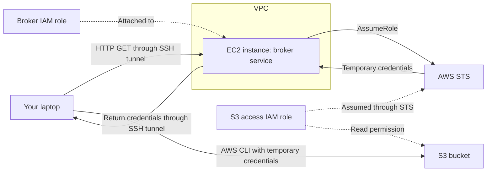
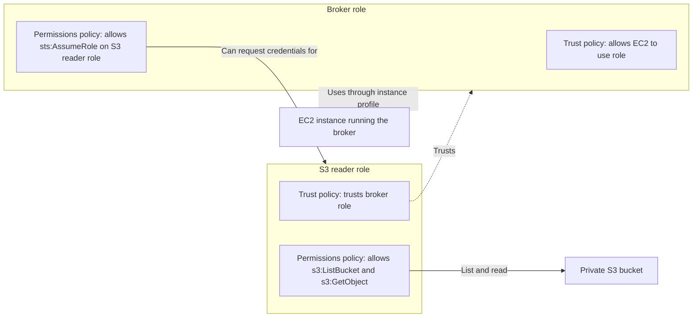

### What is this even about?

- S3 bucket to which direct access is not allowed
  - why? Simply because people might now have aws accounts or the company might not want them to have one for direct use ( non devs )
  - a more compelling reason is having an in house permissioning model and instead of using AWS's version of it, ending up with parallel systems we want to extend the in house one
  - AWS must've done something for it right?
    - yes, if you have an IdP ( identity provider ) that their "AWS IAM Identity Center" supports you can just use that service. For example Okta is one

BUT what if you have something REALLY custom and in house, you can't really do much. AWS allows custom IdPs but you need to satisfy their specs. If my in house retarded things was built with these specs in mind or was easily extendible to support these specs, this whole problem wouldn't be an issue in the first place.

**So what is this really about?**

- S3 bucket access
- access to the broker through SSH for this learning project
- a broker reached through an SSH tunnel that returns temporary credentials for an S3 access role

### What all services do I need and how do I string it all together?

- S3 bucket: contains a file we want to read.
- S3 access role: an IAM role with permission to read the bucket.
- Broker: a small service on EC2 that serves HTTP requests on localhost.
- Broker identity: an AWS identity allowed to assume the S3 access role.
- AWS STS: gives the broker temporary credentials for the role.
- VPC: provides the network for the EC2 instance.

The flow:

1. I send a GET request to the broker through an encrypted SSH tunnel.
2. The broker calls STS `AssumeRole`.
3. STS returns temporary credentials for the S3 access role. Default is 1h, configurable from 15m to 12h max.
4. The broker returns those credentials to me.
5. I use them with the AWS CLI to read the file from S3.

### Infra architecture



Note the the EC2 broker too needs an identity, which is where the Broker IAM role comes in. It does not need access to the bucket itself though, just access to the role on the bucket and ability to assume that role, which is how it returns those creds.

### Making this via clicking things as much as we can

> Ideally all of this can be just done via terraform but I don't wanna be someone who has never seen the AWS console

The broker role and S3 reader role have separate permissions:

The **IAM** setup looks like this



It's a lot of clicking to get this setup, you can just ask some llm for the steps of what and where, but above is how it's set up.

### Progress so far

1. Created a private S3 bucket and uploaded `hello.txt`.
2. Created a broker role and an S3 reader role, with policies connecting them ( as the diagram shows )
3. Launched an EC2 instance and attached the broker role.
4. Used STS to assume the S3 reader role and read `hello.txt` from EC2 ( this is just for verification, do remember to unset stuff if you set any env vars, I had an older cred that expired and was messing with the server startup )
5. Added the broker code and ran the server
6. Port forward via ssh, then curl and test

### Running the broker

To avoid the hassle of a domain and everything, I just do an ssh port forwarding to talk to the server. The connection path AFTER getting the creds will not be via EC2.

```bash
export AWS_REGION=us-east-1
export S3_ROLE_ARN=arn:aws:iam::YOUR_ACCOUNT_ID:role/YOUR_S3_READER_ROLE
make install
make run
```

> what roles is this S3_READER_ROLE? Think what role the ec2 instance's IAM needs to assume. Go to that role and just copy the ARN

Them just forward the port in one terminal and curl from the other.

```bash
ssh -i /path/to/key.pem -L 8443:127.0.0.1:8443 ec2-user@YOUR_EC2_IP
curl http://127.0.0.1:8443/credentials
```

Some extra vm steps to install the basic deps

```bash
sudo dnf install git make
curl -LsSf https://astral.sh/uv/install.sh | sh
```

### Shape of creds?

With all said and done and finally curling, here's what I get

- AccessKeyId
- SecretAccessKey
- SessionToken
- Expiration

A little script to run in another terminal to get the envs right

```bash
creds=$(curl -fsS http://127.0.0.1:8443/credentials) &&
export AWS_ACCESS_KEY_ID=$(echo "$creds" | jq -er '.AccessKeyId') &&
export AWS_SECRET_ACCESS_KEY=$(echo "$creds" | jq -er '.SecretAccessKey') &&
export AWS_SESSION_TOKEN=$(echo "$creds" | jq -er '.SessionToken') &&
unset creds
```

Post this, s3 ls will work
`aws s3 ls s3://ruins-s3-custom-cred-bucket/ --region us-east-1`

**Wait, didn't I set it to block all public access?**

- I was confused about it, apparently public access is just unauthenticated access for anyone over net that knows the url
- it is not in any way related to limiting bucket to a VPC, that's a separate thing entirely
  - that separate thing is that you define it as a bucket policy that requests to the bucket MUST originate from a given VPC only.
- with this the IAM role being used to access the bucket needs to be allowed via the policy, which is the case for me which is why I can access it over internet as I have the needed env vars set.

### A frontend like filestash?

Filestash supports automatic EC2 IAM. What this means is that if you run in an EC2 that has the needed perms to assume role you can then run filestash ON that vm and it'll naturally do the same things we did except on the vm to display it on a frontend.
