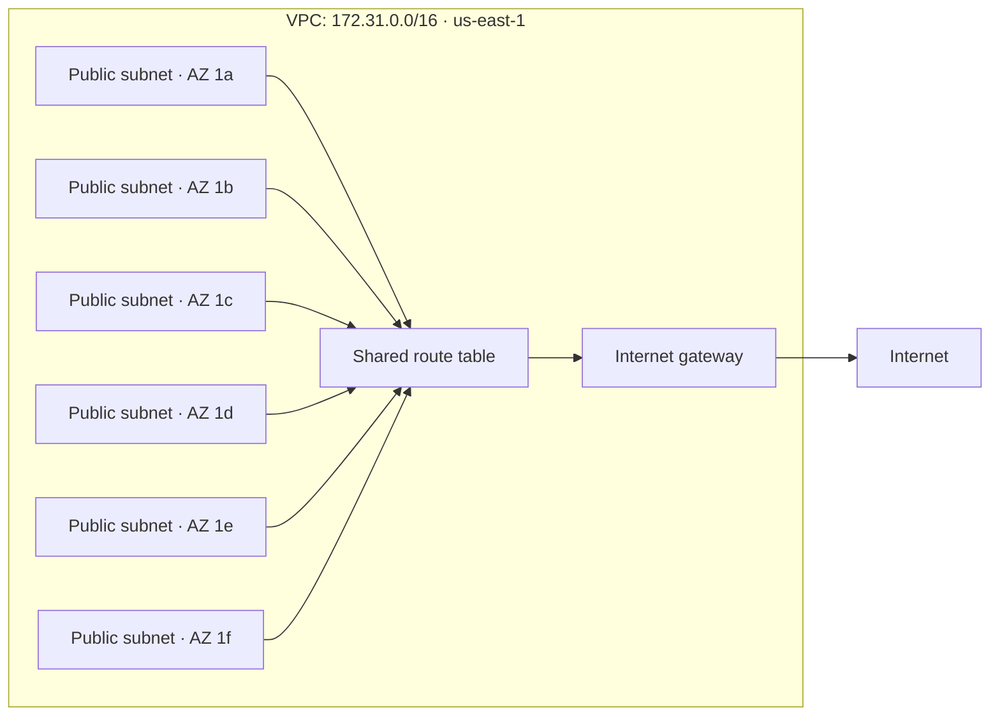

- spans ALL AZ withing a region
- subnets
  - public = has route to the internet
  - private = well, private
  - subents belong to one AZ, but VPC can join these subnets across AZ within a region
  - you generally use the default subnet, more complex subnet configurations come into play whre you have complex rules and isolation boundaries within the different parts of the application
  - **resources that need a network location in your VPC generally use a subnet; networking components that configure the VPC may not**
- what about different regions?
  - for that you need something like "inter-Region VPC"

### So when do I need a VPC?

If you need private networks of any sort of access boundaries between two components, you NEED a VPC.
Some services ALWAYS need a VPC and AWS will just configure you to the default one if you don't specify or overlook that when creating, but a VPC will be there.

Some services like S3 can be accessed via AWS apis ( just like they can be over public APIs and don't necessarily need a VPC ).

Something like EC2, RDS etc always use a VPC. S3, Lambda can work without.

Even within a VPC, if you want to configure public on EC2 and private only on the db, then you split the VPC to have public and private subnets.

### Default VPC example

- `172.31.0.0/16` ( 2^16 ips allowed withing this ) is a private IP range, not a public IP. Subnets use smaller ranges within it.
- The default VPC has six subnets, one per AZ. Their route table sends `0.0.0.0/0` to the internet gateway.
- An EC2 instance also needs a public IP and suitable security group rules for internet access.
- See these connections in the VPC console under **Your VPCs → select VPC → Resource map**.

### Navigating the console

It's ugly but somehow _AWS assistant_ is pretty good.

AWS always has a default VPC created against every subnet. The dropdown on VPCs will show "1" against each region and a 1 overall as well, this overall 1 is 1 for the current region.

If you pick the defult region, it'll show you details on that.

### todo

1. Launch one instance in each of two default subnets.
2. Allow ICMP (ping) between them in their security groups.
3. Connect to one instance and ping the other’s private IP.
4. Remove the ICMP rule and try again.
