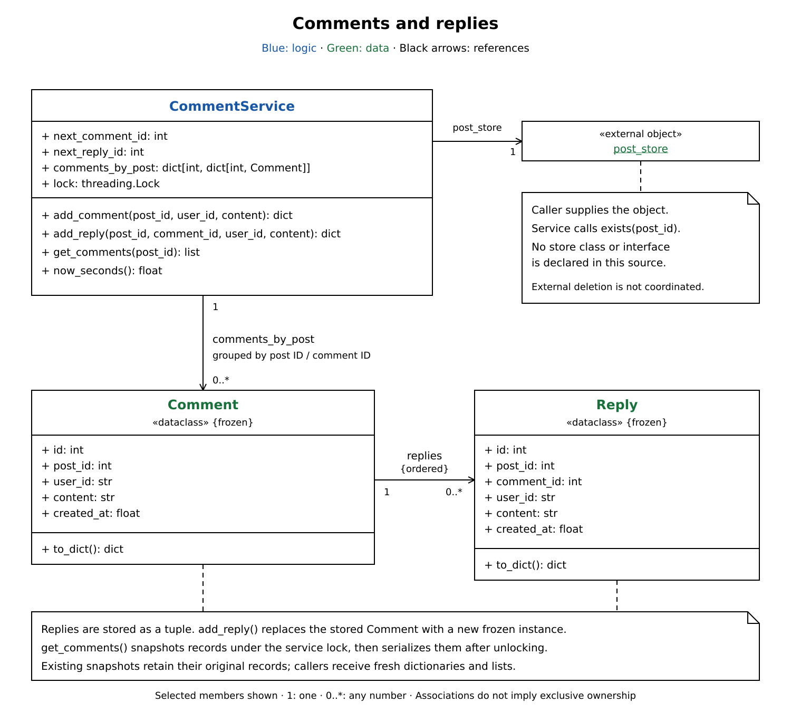

# Comments and replies design

`CommentService` owns comments, ID counters, and locking. An injected `post_store`
checks post existence; immutable `Comment` and `Reply` objects hold the data.
These notes cover `lc _comments_replies.py`.

## Reading the UML

1. **Start with `CommentService`:** coordinates validation, ID allocation, and storage under one lock.
2. **Follow `post_store`:** the caller supplies an object with `exists(post_id)`; post storage stays outside this service. No interface is declared here.
3. **Follow the stored data:** dictionaries group comments by post and comment ID. Each `Comment` holds an ordered tuple of `Reply` objects.
4. **Follow results back:** `to_dict()` creates fresh dictionaries. Callers receive serialized values rather than internal records.

## Happy path

1. `add_comment(post_id, user_id, content)` checks that user and content are nonblank strings.
2. The service locks, checks the post, creates and stores a `Comment`, and advances the comment ID. It unlocks and returns the comment dictionary.
3. `add_reply()` validates text, then locks and finds the comment within that post.
4. It creates a `Reply`, replaces the stored comment with a copy containing the appended reply, and advances the reply ID. It unlocks and returns the reply dictionary.
5. `get_comments(post_id)` locks, checks the post, and snapshots its comments. It unlocks, serializes the snapshot with nested replies, and returns the list.

## Design BOW

- **Post-scoped lookup:** `comments_by_post[post_id][comment_id]` prevents replies from attaching to a comment on another post.
- **Immutable updates:** frozen dataclasses and reply tuples let existing snapshots remain unchanged when a reply is added.
- **Creation order:** dictionaries preserve comment insertion order; tuples preserve reply order. Sorting is unnecessary.
- **Separate identities:** comment and reply counters each start at one and advance independently.
- **Small scope:** in-memory storage; replies are one level deep. Timestamps use `time.time()`; ordering does not depend on them.

## SOLID principles

| Principle | Where / how |
| --- | --- |
| **Single Responsibility** | The service coordinates operations and shared state; data objects provide their dictionary representation. Post existence is delegated to the supplied store. |

## Concurrency

| Concern | Implementation |
| --- | --- |
| **Duplicate IDs / lost replies** | One service lock covers ID allocation, lookup, and storage changes. |
| **Consistent reads** | `get_comments()` snapshots immutable records under lock; serialization happens after unlocking. |
| **Tradeoff** | All posts share one lock. Calls to `post_store.exists()` also hold it. |
| **External state** | The lock protects this service only; it does not coordinate concurrent post deletion in the external store. |

## common mistakes

- Look up a comment within the requested post, not by comment ID alone.
- Lock the whole read/change/write operation; an atomic counter alone cannot prevent lost replies.
- A shallow snapshot works here because records and reply tuples are immutable.
- Preserve insertion order rather than sorting by IDs or wall-clock timestamps.
- Use service methods rather than mutating its public dictionaries. State is process-local and disappears on restart.
