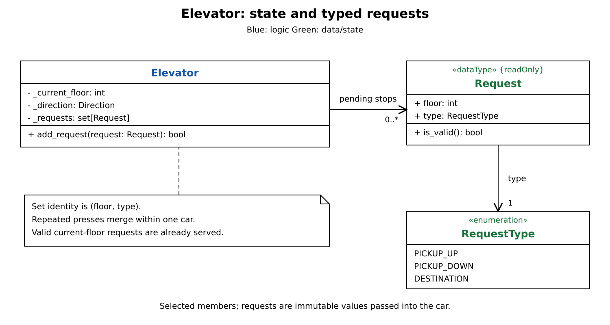
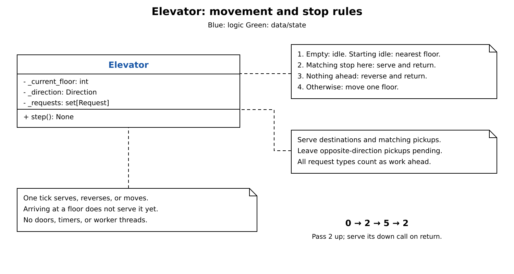
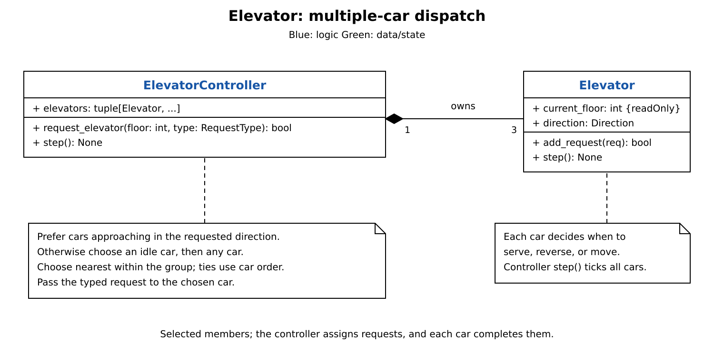

# Elevator: breakdown

[Elevator design](elevator.md) covers the implementation, movement rules, dispatch priorities, and tradeoffs.

| Part | Add |
| --- | --- |
| 1. State and requests | One car and a set of typed stops. |
| 2. Direction and stops | Serve matching calls, reverse, or move. |
| 3. Multiple-car dispatch | Assign hall calls and advance three cars. |

Each diagram shows selected members. Assume ten floors and sequential calls.

## Part 1: State and requests

Start with `Elevator` owning position, direction, and one set of pending requests. A floor alone cannot tell the car whether a waiting passenger wants to go up or down.

- `Request(floor, type)` is immutable. Types are `PICKUP_UP`, `PICKUP_DOWN`, and `DESTINATION`.
- The set merges duplicate floor/type pairs. A destination, up call, and down call at one floor remain separate.
- `add_request()` checks validity and queues the request. A valid current-floor request is already served, so it returns success without adding it.

Keep mutation inside the car. Read-only properties expose its floor and direction; `requests` returns a frozenset copy.

## Part 2: Direction and stops

Reuse the typed set to decide what a car should do on each tick.

1. If the set is empty, stay idle. Otherwise, choose the nearest floor only when starting from idle; distance ties go lower.
2. Serve a destination or matching pickup at the current floor, remove those entries, and end the tick. Leave opposite calls pending.
3. With no eligible stop here, check whether any requested floor lies strictly ahead. If none does, reverse and end the tick.
4. Otherwise, move one floor in the current direction. The next tick can serve that arrival.

For a down call at 2 and a destination at 5, a car starting at 0 passes 2 going up, serves 5, reverses, then returns to serve 2 going down. Opposite calls count as work ahead, so a lone down call at 2 still draws the car upward before it turns there.

## Part 3: Multiple-car dispatch

Add `ElevatorController`, which creates three cars. Hall calls now need a car assignment; cabin destinations still go to the car the passenger boarded.

1. `request_elevator(floor, type)` validates the hall call. Reject `DESTINATION` at this entry point.
2. Prefer cars approaching the floor in the requested direction, then idle cars, then any car. Choose nearest within that group; ties use car order.
3. Pass the same `Request` to the chosen car's `add_request()`. Assignment is immediate, and that car keeps the call until it is served.
4. Controller `step()` calls each car's `step()` once. Each car owns its movement; the controller only coordinates the fleet.

Direction-and-distance selection fits this exercise. It does not estimate the time needed to finish a car's other stops. Requests merge within each car; the controller has no global queue of hall calls.
