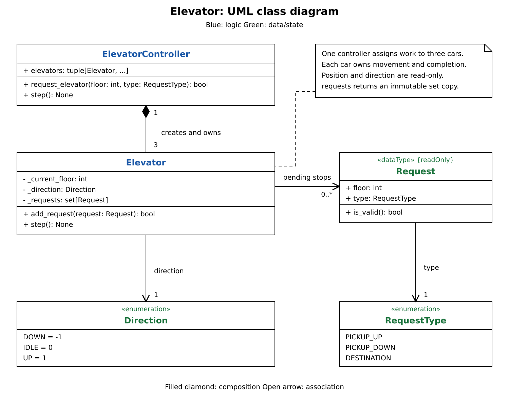

# Elevator design

`ElevatorController` assigns hall calls to three cars and advances them together. Each `Elevator` owns its position, direction, and typed requests, and decides how to serve its stops.

## Movement rules at a glance

A request contains a floor and a type: `PICKUP_UP`, `PICKUP_DOWN`, or `DESTINATION`. The building has ten floors, numbered 0 through 9; every car starts at 0. Calls are sequential and time advances through `step()`.

| Situation | Rule |
| --- | --- |
| Adding a request for the car's current floor | Return success without queuing it; that floor is already served. This applies to every request type. |
| No pending requests | Set direction to idle and stay put. |
| Idle with pending requests | Choose the nearest requested floor; distance ties go to the lower floor. |
| Current floor has a cabin destination or matching hall call | Remove those requests and end the tick without moving. Leave any opposite hall call pending. Set direction to idle if the set becomes empty. |
| No eligible stop here and nothing strictly ahead | Reverse direction and end the tick without moving. Opposite-direction hall calls also count as work ahead. |
| No eligible stop here and work remains ahead | Move one floor. Arrival is served on a later tick. |
| Repeated button press | Merge requests with the same floor and type within that car. Up, down, and destination requests at one floor remain distinct. |

Serving a stop, reversing, and moving each take one tick. Door mechanics, capacity, and emergency behavior are outside this exercise.

## Dispatch rules at a glance

`request_elevator(floor, type)` picks the nearest car in the first nonempty group below. Equal distances use car order. A car can receive more work while it is busy.

| Priority | Eligible cars |
| --- | --- |
| 1 | Cars traveling in the requested direction that have not passed the caller's floor. |
| 2 | Idle cars. |
| 3 | Any car. |

Once assigned, a hall call stays with that car. Cabin destinations go directly to the car the passenger boarded through `add_request(Request(floor, RequestType.DESTINATION))`.

## Reading the UML

1. Start with `ElevatorController`. It creates and owns a tuple of three elevators. `request_elevator()` chooses a car for each hall call; `step()` asks every car to advance once. The tuple index identifies a car.
2. Follow `Elevator`. `_requests` is one set of `Request` records. `add_request()` accepts work; `step()` handles movement and stops. The controller does not change the car's position or remove its requests.
3. Connect `Request` and `RequestType`. A frozen dataclass gives requests equality and hashing by both fields. `Request.is_valid()` checks integer floor bounds and the request type for both entry points. A typed request preserves why the car must stop.
4. Connect `Direction`. Its numeric values supply the movement increment and let the car test whether a floor is ahead. Idle direction is separate from request type: a hall call can ask for up or down, never idle.
5. Read `current_floor`, `direction`, and `requests` as inspection properties. The first two are read-only; `requests` returns a frozenset copy. These give the controller and example the information they need without exposing the working set.

## Happy path

1. Create `ElevatorController()` and call `request_elevator(2, RequestType.PICKUP_UP)`. All cars are idle at 0, so the distance tie assigns the call to car 0.
2. Advance once: car 0 moves to 1. Submit a down call at 4. Car 0 is traveling up, so the controller assigns the call to idle car 1.
3. On the next tick, car 0 reaches 2 and car 1 reaches 1. On the following tick, car 0 serves the up call without moving; car 1 reaches 2.
4. The passenger in car 0 adds `Request(6, RequestType.DESTINATION)`. Later ticks move car 0 toward 6 while car 1 continues toward 4.
5. Car 1 reaches 4 traveling up. Its down call does not match, and no request remains ahead, so the next tick reverses it. Another tick serves the down call at 4 and sets it idle.
6. Car 0 reaches 6, then serves its destination on a separate tick. Both cars now have empty request sets and idle directions; car 2 has stayed idle throughout.

## Design choices

| Choice | Reason and tradeoff |
| --- | --- |
| Separate assignment from movement | The controller compares cars; each car manages its own sweep. A change to dispatch does not need to change stop handling. |
| One set of typed requests | Duplicate presses merge without losing the difference between a destination and a directional pickup. A stop clears only matching requests. |
| Preserve the sweep | Choose nearest only while idle. While moving, continue until no request remains ahead, then reverse. The car turns at requested floors instead of traveling to the building's boundary. |
| Immediate assignment | The controller gives each hall call to a car immediately. There is no unassigned queue, reassignment, or global record of outstanding hall calls. Deduplication is per car. |
| Basic dispatch | Direction and distance keep selection short to explain. The rule does not estimate total pickup time or waiting time; a matching busy car can be chosen over a closer idle car. |
| Validation | `add_request()` returns `False` for noninteger floors, booleans, out-of-range floors, or unknown request types. The controller also rejects `DESTINATION` because its entry point is for hall calls. Valid duplicates and current-floor requests return `True`. |
| Cost | With `E` cars and `R` requests per car, dispatch takes `O(E)` time; a car tick takes `O(R)` time. Adding a valid request is expected `O(1)`. Reading `requests` copies its set in `O(R)` time. Storage is bounded by the distinct floor/type pairs per car. |
| Waiting time | Finite request sets complete. Continuous new traffic can delay pending calls; no maximum wait is promised. |

## Design principles

| Principle | Where / how |
| --- | --- |
| Single responsibility | The controller assigns work and advances the fleet; each elevator owns movement and request completion. |
| Encapsulation | The controller uses car methods and inspection properties. Callers receive immutable requests and a copy of the pending set; Python's underscore privacy remains a convention. |

## Concurrency

Calls are sequential: submit requests, advance a tick, then submit more. The implementation has no threads or locks. A threaded version would need to serialize selection and assignment with movement; otherwise dispatch can use stale state and request sets can change during iteration.

## Common mistakes

- Picking only the closest car ignores whether it is traveling away from the caller. Apply direction eligibility before comparing distance.
- Clearing every request at a stop loses the opposite hall call. Remove only the destination and matching pickup.
- Recomputing the nearest target while moving can cause repeated reversals. Preserve the sweep until no request remains ahead.
- Checking only matching calls for work ahead can miss a floor where the return trip must begin. All queued request types count.
- Treating a turnaround as a building-boundary rule sends cars farther than needed. Reverse based on pending work.
- Adding a policy interface for one dispatch rule adds no useful choice. Keep this rule in the controller until another policy is required.

The exercise follows the scheduling and coordination scope of [Hello Interview's Elevator guide](https://www.hellointerview.com/learn/low-level-design/problem-breakdowns/elevator). Use the [breakdown](elevator-breakdown.md) to reconstruct it one responsibility at a time.
