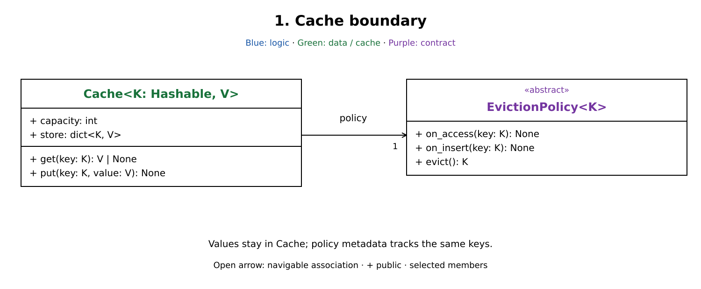
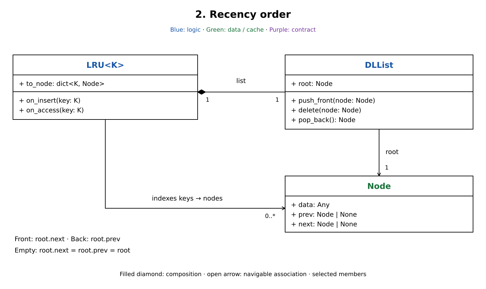
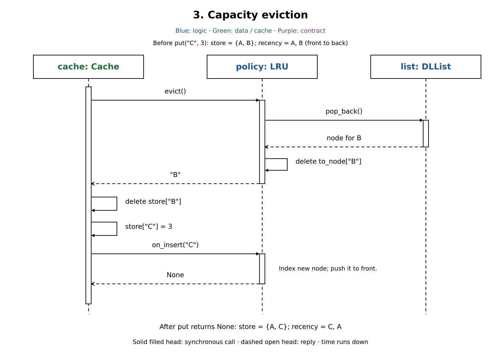
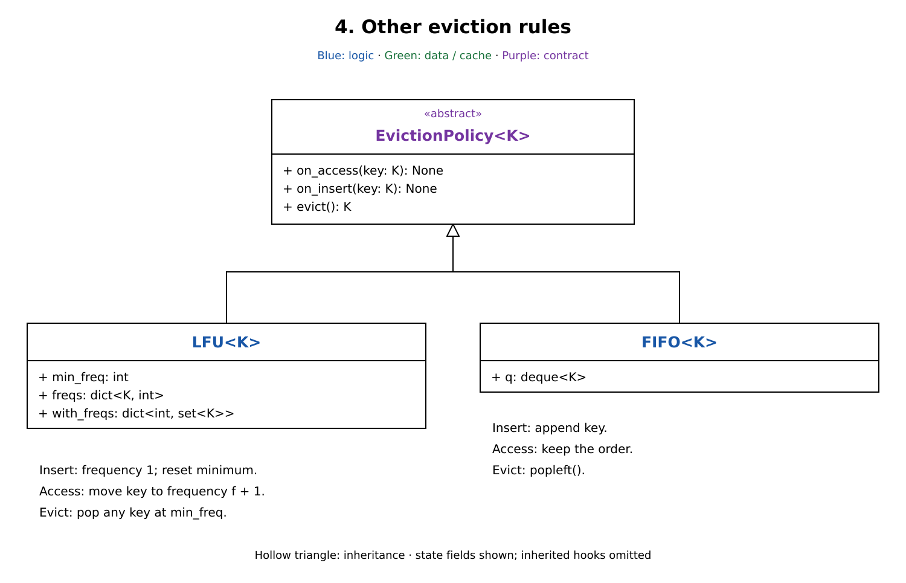

# LRU cache: breakdown

[LRU cache design](lru_cache.md) covers the complete implementation, walkthrough, and concurrency limits.

| Part | Add |
| --- | --- |
| 1. Cache boundary | Store values and delegate key tracking to a policy. |
| 2. Recency order | Find and move LRU nodes without scanning. |
| 3. Capacity eviction | Remove a victim before registering a new key. |
| 4. Other eviction rules | Reuse the cache with frequency or insertion order. |

Each diagram shows selected members. Assume a positive integer capacity, hashable keys, one fresh policy per cache, and calls from one thread.

## Part 1: Cache boundary

`Cache` owns `capacity` and `store: dict[K, V]`. Give the policy only keys: it needs usage history to choose a victim, while values remain in the cache.

`EvictionPolicy` defines the coordination points: `on_insert(key)` registers a new key, `on_access(key)` records use of an existing key, and `evict()` removes a victim from policy metadata and returns its key. This is the Strategy pattern; the caller chooses the rule when constructing `Cache`.

Keep the same keys in `store` and policy metadata after every successful operation. A miss returns `None` without a hook. The cache deletes a value only after the policy returns its victim.

## Part 2: Recency order

Reuse that boundary with `LRU`. It needs both fast key lookup and an order that changes on each hit:

- `to_node` finds the key's node directly. Each real `Node.data` holds a key.
- `DLList` keeps a circular sentinel `root`. `root.next` is most recent; `root.prev` is least recent. Empty means both links point to `root`.
- `on_insert(key)` creates a node, indexes it, and calls `push_front(node)`.
- `on_access(key)` finds the existing node, calls `delete(node)`, then `push_front(node)`. This reuses the node and takes constant link work.

A successful `get()` touches the key before returning its value. An existing-key `put()` touches it before overwriting its value; it neither evicts nor registers a second node.

## Part 3: Capacity eviction

A new key needs space when `len(store) == capacity`. Reuse the order from Part 2: after inserting A and B, accessing A leaves A at the front and B at the back.

1. `Cache.put("C", 3)` calls `policy.evict()` before storing C.
2. LRU checks it has keys, removes the back node through `DLList.pop_back()`, deletes B from `to_node`, and returns `"B"`.
3. The cache deletes B from `store`, stores C, then calls `on_insert("C")`.
4. LRU indexes C at the front. `put()` returns `None` with A and C in both value storage and metadata.

When the cache has room, skip eviction and perform the same store-then-register steps. The hooks do not roll back failures; a raised exception can leave storage and metadata out of sync.

## Part 4: Other eviction rules

Keep `Cache` and its hook order. Replace only the policy and its key metadata.

`LFU` needs a frequency per key, a set of keys per frequency, and `min_freq`:

1. Insert at frequency 1 and reset `min_freq` to 1.
2. On access, move the key from bucket `f` to `f + 1`. If the move empties the minimum bucket, increment `min_freq`.
3. Evict any key from the minimum bucket and delete its frequency entry. Ties are arbitrary.

The cache's following insertion resets the minimum; standalone repeated evictions are not supported reliably. Empty frequency buckets remain allocated.

`FIFO` needs only a deque: append on insertion, do nothing on access, and `popleft()` on eviction. Updating a stored value therefore preserves its original place in the queue.
