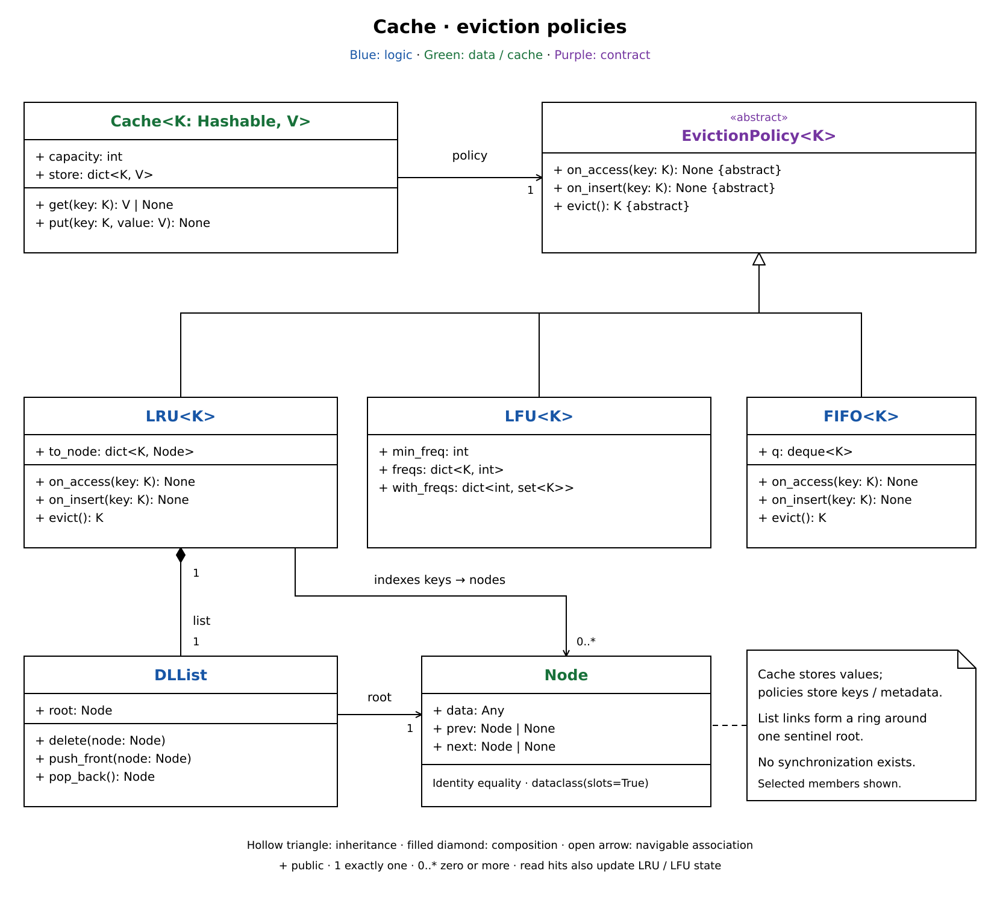

# LRU cache design

`Cache` owns capacity and stored values. An injected `EvictionPolicy` tracks keys and chooses which one to remove; `LRU`, `LFU`, and `FIFO` provide different rules.

These notes cover [lru_cache.py](lru_cache.py). For incremental recall, use the [breakdown](lru-cache-breakdown.md).

## Reading the UML

1. Start with `Cache`. Its `store` dictionary owns values, and `capacity` limits the number of keys. Callers use `get()` and `put()`; policies never receive values.
2. Follow `EvictionPolicy`. `on_insert(key)` registers a new key, `on_access(key)` updates an existing key's metadata, and `evict()` removes a victim from that metadata and returns its key. The cache then deletes the corresponding value.
3. Follow `LRU` to its key-to-`Node` map and owned `DLList`. The map finds a node without scanning; the list keeps the most recently used key at the front and the least recently used key at the back.
4. Follow `DLList.root` to the circular sentinel. Its `next` and `prev` links point to itself when empty. Real nodes hold keys in `data`, compare by identity, and link to their neighbors.
5. Other policies use the same contract. `LFU` owns frequencies, sets of keys grouped by frequency, and `min_freq`; `FIFO` owns a deque of keys in insertion order. Results still come from `Cache.store`.

## Happy path

1. Create `Cache(2, LRU())`. `put("A", 1)` and `put("B", 2)` each store the value, then call `on_insert()` to create and index a node at the front. The order is B, A.
2. `get("A")` finds A in `store`, calls `on_access("A")`, and returns `1`. LRU unlinks A's node and pushes it to the front; the order is A, B.
3. `put("C", 3)` sees a new key and a full cache, so it calls `policy.evict()`.
4. LRU calls `list.pop_back()`, deletes B from `to_node`, and returns `"B"`.
5. The cache deletes B's value, stores C, then calls `on_insert("C")`. LRU creates C's node at the front.
6. `put()` returns `None`. A and C remain cached, with C most recent. These steps use no locks.

## Design choices

- The constructor rejects `capacity < 1`. Callers must supply a positive integer capacity and hashable keys; type annotations do not enforce these requirements at runtime. State lives in memory.
- A cache miss returns `None` without notifying the policy. Updating an existing key calls `on_access()` before replacing its value and does not evict or call `on_insert()`.
- Dictionary lookup plus a doubly linked list gives LRU average constant-time lookup, insertion, promotion, and eviction. The sentinel avoids special cases at either end. `DLList.delete()` expects a linked real node; LRU checks for an empty policy before `pop_back()`.
- `LFU` inserts keys at frequency 1. Access moves a key from frequency `f` to `f + 1`; if it empties the minimum bucket, `min_freq` increases by one. A set chooses arbitrarily among equal-frequency keys.
- `LFU.evict()` leaves `min_freq` unchanged. The next `on_insert()` resets it to 1, matching a full-cache insertion. Empty frequency buckets remain allocated, so repeated hits can grow metadata even when cache capacity is fixed.
- `FIFO.on_access()` does nothing. Reads and existing-key writes keep their original insertion position; only insertion and eviction change its deque.
- Policy hooks run inline and exceptions propagate. There is no rollback: an insertion hook can fail after the value is stored, or an eviction can remove metadata before value deletion fails. Use a fresh, empty policy for each cache and keep its state paired with `store`.
- LRU can lose useful entries during a scan larger than capacity. A probation/protected split such as SLRU would change that behavior; this implementation has no such policy. TTL or arbitrary deletion would also need a way to remove policy metadata.

## Design patterns

| Pattern | Where | Purpose |
| --- | --- | --- |
| Strategy | `Cache` receives an `EvictionPolicy`; `LRU`, `LFU`, and `FIFO` implement it. | Choose eviction rules without changing storage operations. |

## Design principles

| Principle | Where / how |
| --- | --- |
| Single responsibility | `Cache` manages values and capacity; policies manage eviction metadata. `DLList` handles link changes. |
| Open/closed | Add a policy implementing the existing hooks without changing `Cache.get()` or `put()`. Policies needing extra events require a contract change. |
| Dependency inversion | `Cache` depends on the abstract policy contract; callers choose the implementation. |

## Concurrency

| Concern | Implementation |
| --- | --- |
| Shared state | No locks exist. Concurrent operations can desynchronize `store` and policy metadata; use this implementation from one thread or serialize whole operations externally. |
| Read mutations | Cache hits change LRU and LFU metadata, so `get()` needs the same protection as `put()` if concurrency is added. |
| Ownership | Use one fresh policy per cache. Direct policy calls, sharing a policy, or replacing it after insertion can break the correspondence between stored keys and metadata. Public fields also allow callers to violate invariants. |

## Common mistakes

- Remove a victim from both policy metadata and `store`; `evict()` handles the first and `Cache.put()` handles the second.
- Call `on_insert()` only for a new key. Repeating it for an existing LRU key leaves an extra list node outside the index.
- Keep eviction followed by insertion for LFU; repeated standalone evictions can leave `min_freq` pointing at an empty bucket.
- Do not treat a cache hit as a read-only operation or assume an individual dictionary operation makes the full cache operation atomic.
- `get()` returns `None` for both a missing key and a stored `None` value.
