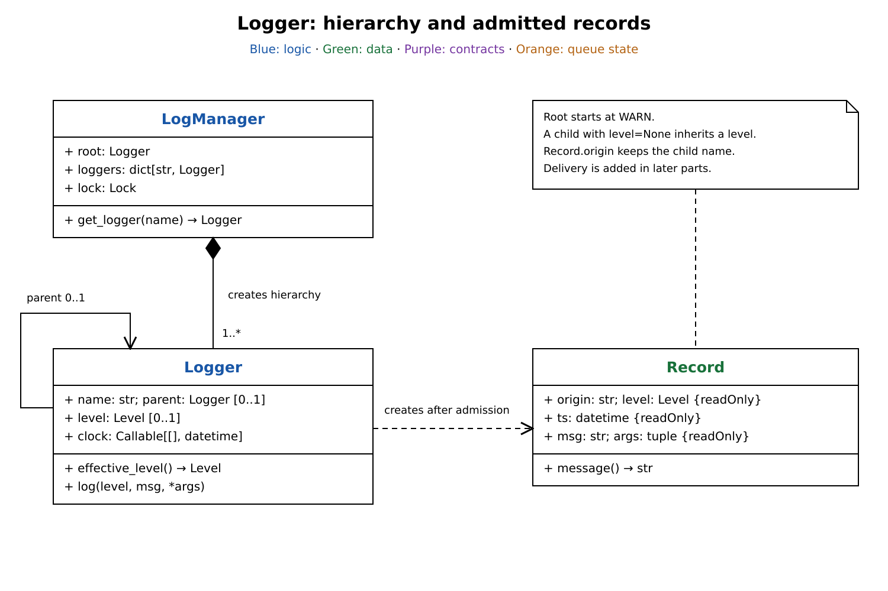
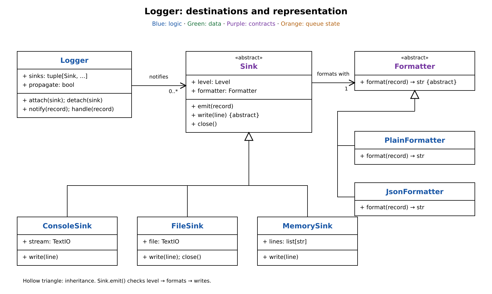
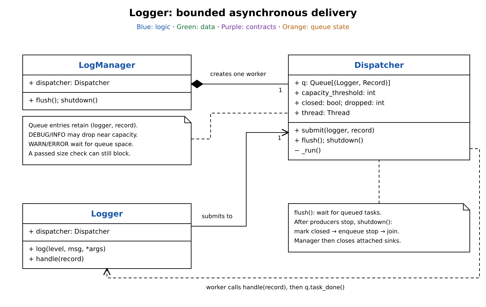

# Logger: breakdown

[Logger design](logger.md) covers the full implementation, walkthrough, and concurrency limits. Rebuild it in these parts:

| Part | Add |
| --- | --- |
| 1. Hierarchy and records | Reuse named loggers, inherit a level, and capture an admitted event. |
| 2. Destinations and formatting | Deliver to several sinks and choose each output format. |
| 3. Queued delivery | Move output to one worker, bound pending work, and drain it at shutdown. |

The diagrams show selected members. The implementation is in [logger.py](logger.py).

## Part 1: Hierarchy and records

Start with shared configuration. `LogManager` owns a root logger and a registry keyed by dotted names.

`get_logger("app.api")` locks the registry and creates or reuses both `app` and `app.api`. Each node points to its parent, and repeated lookups return the same node. The root starts at `WARN`; a child's `level = None` means `effective_level()` follows parents until it finds an explicit level.

Now capture a log event:

1. `Logger.log(level, msg, *args)` rejects levels below `effective_level()`.
2. For an admitted event, read the injected clock and create a frozen `Record` containing the originating logger name, level, time, template, and arguments.
3. Keep interpolation in `Record.message()` so output can format the record later. Mutable argument objects must stay unchanged until delivery.

The record keeps the originating name even when parent loggers deliver it.

## Part 2: Destinations and formatting

One admitted event may need console output, a file, and an in-memory copy. Add `Logger.sinks` as a tuple of sink references and use `attach()` or `detach()` to replace that tuple.

`Sink.emit(record)` fixes the common sequence: check the sink's level, call `formatter.format(record)`, then call `write(line)`. Subclasses provide console, append-mode file, or memory output. This is Template Method: destinations reuse the filtering and formatting steps.

A sink holds a `Formatter`, with `PlainFormatter` as its default. `JsonFormatter` provides another representation through the same contract. This is Strategy: choosing JSON requires no change to the destination.

Add routing to the existing hierarchy:

1. `Logger.notify()` calls each attached sink's `emit()`. It reports each failure to standard error and continues with the other sinks: the Observer pattern.
2. `Logger.handle()` notifies locally, then calls `parent.handle()` when propagation is enabled: a Chain of Responsibility that can deliver at several levels.
3. Preserve the original record throughout. Parent logger levels are not checked again; each sink applies its own threshold.

Attaching one sink at multiple levels produces duplicate output. Configure sinks before concurrent use; tuple replacement stabilizes iteration but does not synchronize configuration changes.

## Part 3: Queued delivery

Writing can block the caller. Keep routing unchanged and insert one `Dispatcher` shared by all loggers in the manager.

`log()` submits `(self, record)` to the bounded queue. The dispatcher worker takes each pair, calls `logger.handle(record)`, then marks the task done. Caller-side admission happens before queueing; sink filtering and interpolation happen on the worker.

Bound pending work with two policies inside `submit()`:

- Drop DEBUG/INFO when the observed queue size is at least `capacity - capacity // 5`; increment `dropped`.
- Otherwise use blocking `q.put()`. WARN/ERROR therefore wait for space. Concurrent producers can also fill the queue after a low-level record passes the size check, making that submission wait.

Reject nonpositive capacity. The size check and drop counter are approximate under contention.

`flush()` waits for task completion, not file-buffer flushing. Stop producers before calling `shutdown()` once: it marks the dispatcher closed, enqueues a stop sentinel behind pending work, and joins the worker. The manager then closes each distinct attached sink. A submission racing shutdown can land after the sentinel because the closed check and enqueue are separate operations.
