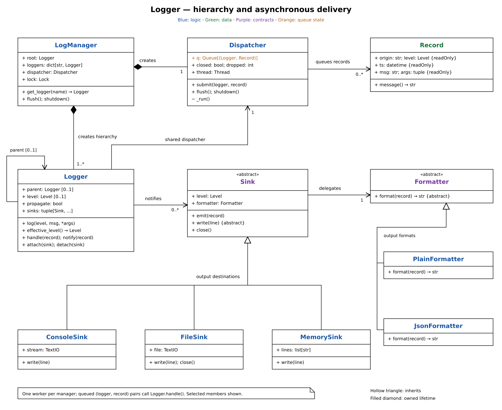

# Logger design

`LogManager` owns the logger hierarchy and a shared `Dispatcher`. One worker delivers
records to sinks.

## Reading the UML

1. **Start with `LogManager`:** creates the logger hierarchy and shared dispatcher.
2. **Follow `Logger` to its parent:** inherited levels and parent sinks keep common configuration at the root.
3. **Follow the dispatcher:** a bounded queue moves writing off caller threads; the worker calls each queued logger's `handle()`.
4. **Follow sinks and formatters:** sinks choose destinations; formatter strategies choose representation. Add either without changing logger delivery.
5. **Connect `Record`:** carries origin, level, time, message, and arguments; sinks format it independently.

## Happy path

1. Set the root level to INFO, attach a `ConsoleSink`, and obtain `app.api` through `get_logger()`.
2. Caller invokes `logger.info()`. `log()` checks the inherited level, reads the clock, and creates a `Record`.
3. With room, `Dispatcher.submit()` queues the logger and record.
4. The worker dequeues the pair and calls `Logger.handle()`, which notifies local sinks and propagates to parents.
5. At the root, `Sink.emit()` checks its threshold, calls the formatter, then `ConsoleSink.write()` prints the line.
6. The worker marks the queue item done. `flush()` waits for queued work; after producers stop, `shutdown()` joins the worker and closes sinks.

## Design BOW

- **Two thresholds:** Logger levels control admission; sink levels control destinations. Parent logger levels are not rechecked during propagation.
- **Deferred formatting:** Worker-side `Record.message()` interpolates arguments; an injected clock controls timestamps.
- **Backpressure:** Near capacity, DEBUG/INFO records are dropped; WARN/ERROR wait for queue space.
- **Lifecycle:** Managers are ordinary instances. Explicit shutdown matters because the worker is a daemon.

## GoF patterns

| Pattern | Where | Purpose |
| --- | --- | --- |
| **Strategy** | `Formatter` implementations | Swap plain text and JSON independently of destinations. |
| **Template Method** | `Sink.emit()` → `write()` | Share filtering and formatting; subclasses supply writing. |
| **Observer** | Logger's attached sinks | Deliver a record to each subscribed destination. |
| **Chain of Responsibility** | `Logger.handle()` → parent | Continue delivery up the hierarchy when enabled. |

## SOLID principles

| Principle | Where / how |
| --- | --- |
| **Single Responsibility** | Manager builds the hierarchy; dispatcher schedules; formatters render; sinks write. |
| **Open/Closed** | Add sink or formatter subclasses without changing delivery. |
| **Dependency Inversion** | Loggers use `Sink`; sinks use `Formatter` contracts. |

## Concurrency

| Concern | Implementation |
| --- | --- |
| **Logger creation** | Manager lock prevents duplicate hierarchy nodes. |
| **Output ordering** | A thread-safe queue feeds one worker per manager; sink writes serialize there. |
| **Sink failures** | Each `emit()` failure is caught so other sinks continue. |
| **Configuration** | Tuple snapshots stabilize iteration; concurrent configuration changes are not synchronized. |
| **Limits** | Queue-size checks and the dropped counter are approximate; submission can race shutdown. |

## common mistakes

- Stop producers before shutdown: the closed check and enqueue are not atomic; late records can be stranded and block `flush()`.
- Configure before concurrent use; tuple snapshots do not prevent lost concurrent attachment changes.
- Flush and shut down explicitly; process exit can discard queued records.
- Avoid attaching the same sink at several hierarchy levels unless duplicate output is intended.
