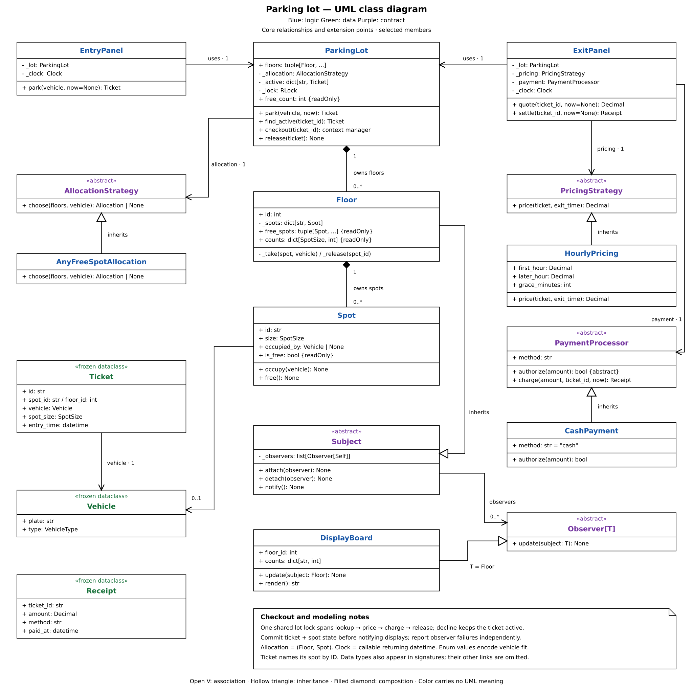

# Parking lot design

`ParkingLot` owns the parking state and lock, and uses an allocation strategy to choose a spot. `ExitPanel` coordinates pricing and payment before the lot releases the vehicle.

## Reading the UML

1. Start with `ParkingLot`. Its private floor map, active tickets, and lock keep tickets and occupied spots in sync.
2. Each floor owns its spots, and each spot tracks its occupant. IDs and spot sizes are read-only. Occupancy changes through internal methods.
3. `EntryPanel` supplies a UTC time. The allocation strategy chooses a spot, the lot checks ownership, and the spot checks whether the vehicle fits.
4. `ExitPanel` prices the stay and charges for it when a fee is due. The lot's internal `_checkout()` keeps the stay active until those steps succeed, then releases it.
5. `Vehicle`, `Ticket`, and `Receipt` are immutable records passed between components. The ticket stores spot size at entry, so pricing needs no mutable spot reference.
6. During setup, `DisplayBoard` registers its `update()` method as a floor callback. The floor calls it after the state changes are complete. This uses callbacks without observer base classes.

## Happy path

1. `EntryPanel.park()` supplies the entry time and calls `ParkingLot.park()`.
2. The lot acquires its lock and rejects an already parked plate. It then asks `AllocationStrategy.choose()` for a spot.
3. The lot checks that the floor belongs to it. The floor checks ownership of the spot, which must be free and large enough for the vehicle.
4. The lot registers a `Ticket`, notifies displays, unlocks, and returns the ticket.
5. `ExitPanel.settle(ticket.id)` supplies the exit time and enters `ParkingLot._checkout()`. The lot locks, finds the active ticket, and marks checkout in progress.
6. The panel validates the exit time and fee. A positive fee calls `PaymentProcessor.charge()`; a zero fee creates a free receipt without calling payment.
7. When the block succeeds, the nested `release()` helper asks the floor to free the spot. The lot removes the ticket and updates displays. Checkout clears its marker and unlocks; the panel returns the receipt.

## Design choices

- The lot keeps spots and tickets consistent; the exit panel coordinates payment. `_checkout()` is internal, and its nested `release()` helper is only available within that method. Callers use the panel to settle a stay.
- Allocation proposes a spot. The lot, floor, and spot check membership, availability, and fit before changing state.
- Counts are calculated from spots. There is no separate availability index to keep in sync. Admission and counts use linear scans.
- Each consistently formatted plate can have one active stay. Vehicle enum values name the minimum spot size; each vehicle occupies one spot.
- Validate `Decimal` amounts and round them to cents. Supplied times and injected clocks must use UTC timestamps with timezone information. The default clock uses `datetime.now(UTC)`.
- Up to 15 minutes is free. After that, each started hour is charged from entry: `4.00` for the first, then `3.50` per hour.
- `main()` wires a floor, board, lot, and panels together, then runs a two-hour stay costing `7.50`. `CashPayment` simulates confirmed cash payment.

## Design patterns

| Pattern  | Where                                                       | Purpose                                                                                           |
| -------- | ----------------------------------------------------------- | ------------------------------------------------------------------------------------------------- |
| Strategy | `AllocationStrategy`, `PricingStrategy`, `PaymentProcessor` | Change spot selection, pricing, or payment by passing a different implementation.                 |
| Observer | `Floor.attach(board.update)` and `_notify()`                | Floors call registered display callbacks after state changes. No inheritance framework is needed. |

## Design principles

| Principle             | Where / how                                                                                                                                  |
| --------------------- | -------------------------------------------------------------------------------------------------------------------------------------------- |
| Single responsibility | The lot maintains state, and the exit panel coordinates checkout. Separate components handle allocation, pricing, payment, and presentation. |
| Open/closed           | Alternative policies can use the existing contracts. A policy that needs new inputs may also need an interface change.                       |
| Dependency inversion  | The lot and exit panel depend on abstract policy and payment contracts. `main()` and `build_lot()` choose the concrete implementations.      |

## Concurrency

| Concern            | Implementation                                                                                                                                                          |
| ------------------ | ----------------------------------------------------------------------------------------------------------------------------------------------------------------------- |
| Double allocation  | One lot lock covers the duplicate-plate check through spot selection, occupancy, and ticket registration.                                                               |
| Double charging    | All exit panels share the lot lock from ticket lookup through pricing, payment, and release.                                                                            |
| Recursive checkout | `_checking_out` rejects another settlement of the same ticket on the same thread. `finally` clears the marker whether checkout succeeds or fails.                       |
| Reentrant reads    | `RLock` allows nested `find_active()` calls and callbacks that query the lot while it holds the lock.                                                                   |
| Payment failure    | An exception in the checkout block skips release. The ticket stays active and the spot stays occupied, ready for a retry.                                               |
| Displays           | Callbacks read committed state under the lot lock. The floor logs each callback failure separately.                                                                     |
| Ownership          | Each floor and spot belongs to one lot. During setup, register callbacks that only read state. Floor methods rely on the lot's lock.                                    |
| Tradeoff           | Payment and display callbacks block other operations. State lives in one process's memory. Real payments need persistent records to resolve uncertain payment outcomes. |

## Common mistakes

- Keep floors and spots fixed after construction. Read-only IDs keep dictionary lookups valid.
- Lock the entire checkout. `RLock` alone does not stop recursive charging of the same ticket.
- Commit spot and ticket state before notifying displays. Log each observer failure separately.
- Reject duplicate floor or spot IDs, duplicate active plates, blank plates, and invalid capacity counts.
- Validate `Decimal` rates and amounts. Reject negative or nonfinite values and invalid grace periods.
- Use UTC timestamps with timezone information, including explicit timestamps and injected clocks. Reject exits before entry.
- Return immutable records and read-only properties. A tuple of live objects still allows those objects to change.
- Treat quotes as advisory because settlement computes the fee again. Python's internal-method privacy is a convention.
- Naively using a `threading.Lock` instead of `RLock`
