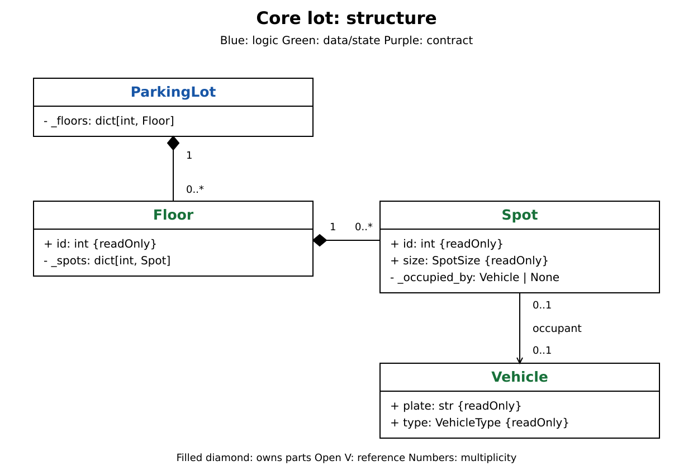
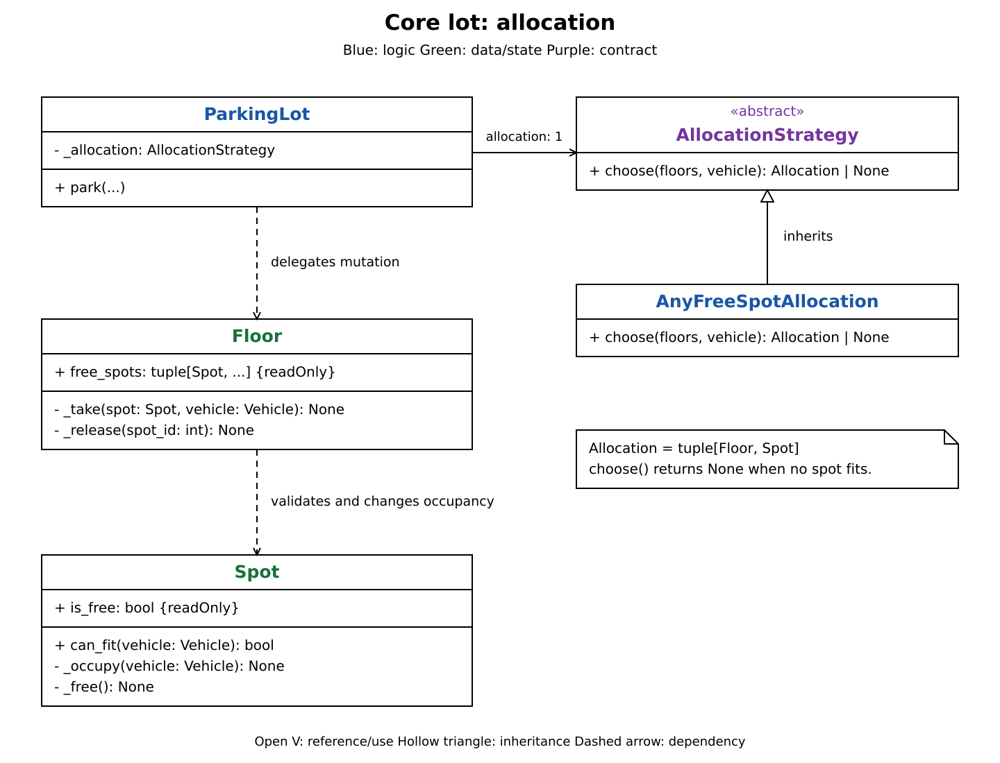
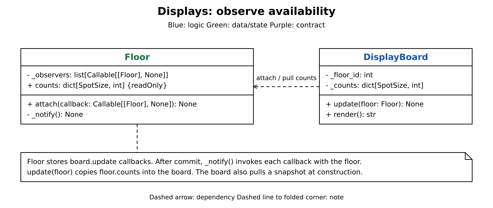
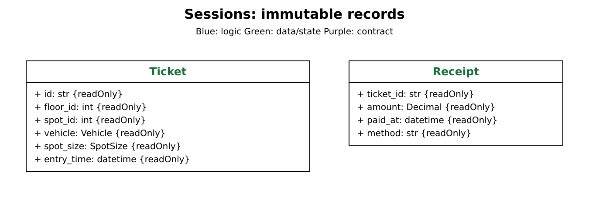
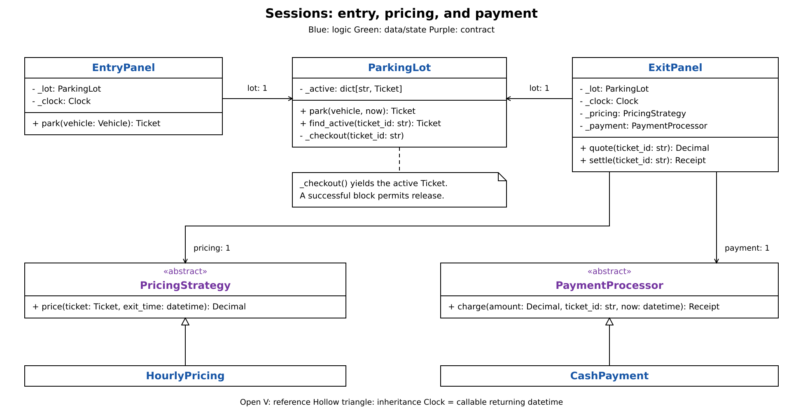

# Parking lot: breakdown

Build the design in three parts. [Parking lot design](<parking lot.md>) covers the complete implementation, walkthrough, and concurrency details.

| Part | Add |
| --- | --- |
| 1. Core lot | Ownership first, then spot allocation. |
| 2. Displays | Availability counts and change notifications. |
| 3. Entry, exit, and payment | Session records, panels, pricing, and payment. |

Each diagram shows only the members needed for that step. Assume in-memory state and simulated payment.

# Part 1: The core lot

## ① Structure and data relationships

Start with the physical parts: a lot owns floors, each floor owns spots, and a spot holds at most one vehicle.

Keep `VehicleType` and `SpotSize` separate. A compatibility rule connects them: a car needs at least a compact spot, while a motorcycle also fits larger spots. `Vehicle` is an immutable record; its type needs no subclass hierarchy.

## ② Allocation behavior

Add a policy for choosing a compatible free spot.

1. `ParkingLot` asks `AllocationStrategy.choose(floors, vehicle)` for a candidate.
2. `AnyFreeSpotAllocation` scans floors and their free spots, returning the first compatible `(Floor, Spot)`, or `None`.
3. The lot checks the floor belongs to it, then calls `floor._take(spot, vehicle)`.
4. The floor checks spot ownership; the spot checks availability and fit before recording the vehicle.

The strategy selects; the owning objects change state. This is the Strategy pattern: another selection policy can use the same contract. Releasing follows the same ownership path, ending at `Spot._free()`.

# Part 2: Displays

A board needs free counts by floor and spot size. Reuse `Floor`, which already owns the spots.

## ① Add the availability view and subscription

- `Floor.counts` scans free spots and counts them by `SpotSize`. Each spot contributes once, regardless of which vehicles fit.
- `DisplayBoard` observes one floor, registers `board.update` through `floor.attach()`, and pulls an initial snapshot.
- The floor owns availability; the board stores a copy for rendering.

## ② Notify after occupancy changes

After committing both occupancy and ticket state, the lot calls `floor._notify()`. The floor invokes each registered callback with itself; `board.update(floor)` pulls fresh `floor.counts`.

This is the Observer pattern using callbacks. A failed display update is logged independently, so it cannot undo parking or prevent other boards from updating.

# Part 3: Entry, exit, and payment

Wrap allocation and release in a parking session. Panels supply time; the lot keeps the session tied to its occupied spot.

## ① Add the session records

`Ticket` captures the assignment and entry time. Its immutable vehicle and spot-size snapshot give pricing the entry facts without reading a mutable spot. `Receipt` records a successful settlement. Use `Decimal` for money.

Add `_active: dict[str, Ticket]` to the lot. `park()` allocates a spot and registers its ticket. Reject a second active stay for the same plate; reject unknown or settled ticket IDs at checkout.

## ② Entry panel: supply the time

`EntryPanel.park(vehicle)` reads its injected clock and returns `lot.park(vehicle, now)`. `Clock` is a callable returning a UTC timestamp with timezone information. The lot receives time as an argument.

## ③ Exit panel: price, pay, then release

Keep pricing and payment separate: `PricingStrategy.price(ticket, exit_time)` calculates a fee; `PaymentProcessor.charge(amount, ticket_id, now)` returns a receipt after payment succeeds. `HourlyPricing` and `CashPayment` are the starting implementations.

`ExitPanel.quote()` previews the fee. `settle()` calculates it again:

1. Read the clock and enter `lot._checkout(ticket_id)` to get the active ticket.
2. Ask pricing for the fee. Charge a positive amount; create a free receipt for zero.
3. On success, `_checkout()` releases the spot, removes the active ticket, and notifies the floor's displays.
4. Return the receipt.

If pricing or payment raises, checkout leaves the ticket active and the spot occupied. Release belongs on the successful path.
