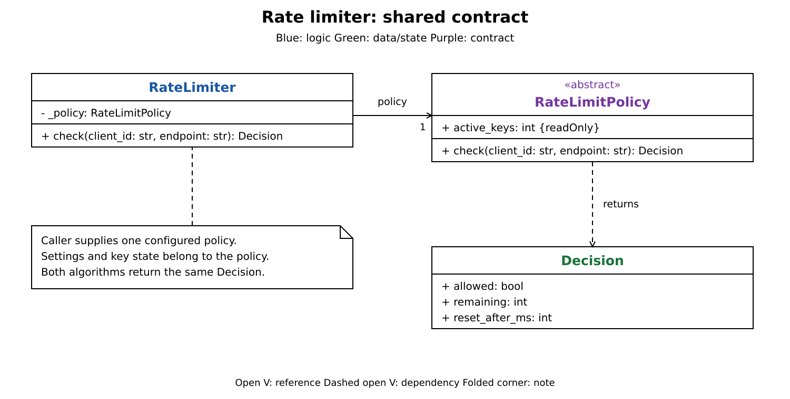
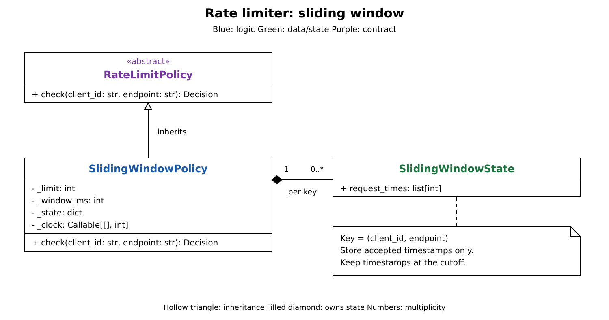
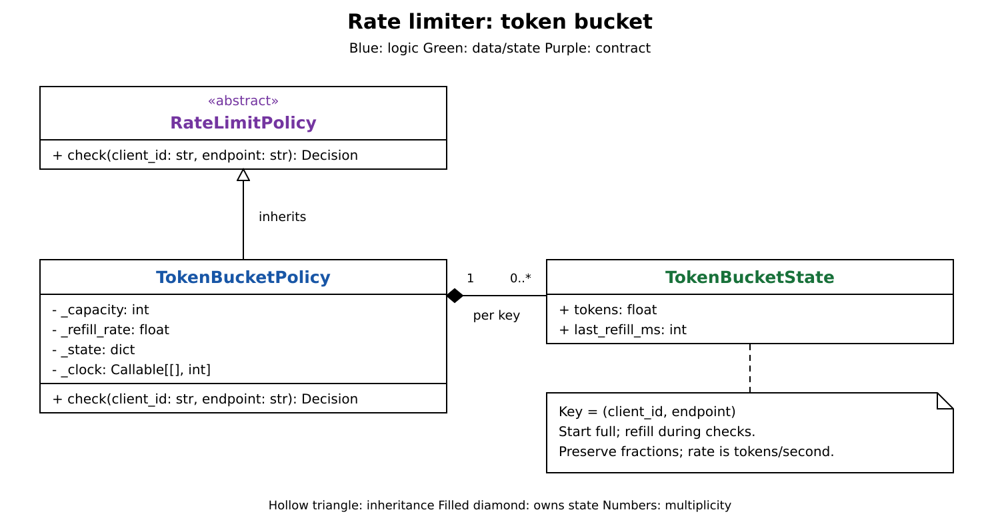
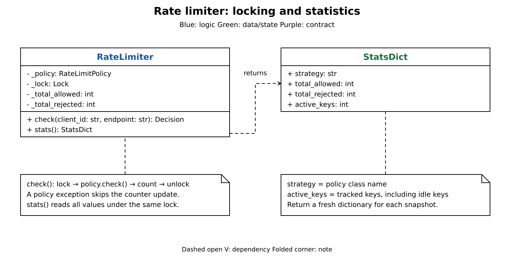

# Rate limiter: breakdown

[Rate limiter design](rate_limiter.md) covers the full implementation, walkthrough, and concurrency details for `rate_limiter.py`.

| Part | Add |
| --- | --- |
| 1. Shared contract | A limiter, its configured policy, and the returned decision. |
| 2. Sliding window | Per-key request history and a limit over that history. |
| 3. Token bucket | An alternative policy with burst capacity and gradual refill. |
| 4. Locking and statistics | Atomic checks and consistent counters. |

Each diagram shows selected members. Both algorithms use in-memory state keyed by `(client_id, endpoint)` and a nondecreasing clock in integer milliseconds.

## Part 1: Shared contract

Callers need the same admission API whichever algorithm they choose.

`RateLimiter` holds a caller-supplied `RateLimitPolicy`. The policy exposes `check(client_id, endpoint)` and `active_keys`; each check returns a `Decision` with admission, remaining whole requests, and a retry delay. An accepted decision has zero delay.

This is the Strategy pattern: the caller configures an algorithm once, and the limiter delegates decisions through the common contract. Algorithm settings and state belong to the policy.

## Part 2: Sliding window

To enforce a request count over a moving window, the policy needs a history for each key.

Add `SlidingWindowPolicy` and its `_state` map. Each value is a `SlidingWindowState` containing sorted accepted timestamps. Validate positive `limit` and `window_ms` at construction; start a new key with an empty list.

1. Read the clock and find the cutoff `now - window_ms`.
2. Use `bisect_left()` and delete timestamps strictly below the cutoff.
3. If fewer than `limit` timestamps remain, append `now` and return an allowed decision with the unused count.
4. Otherwise, reject without appending; report `oldest + window_ms - now` as the delay.

With `limit=2` and `window_ms=1000`, two checks at `5000` succeed. A third at `6000` still fails with zero delay because timestamps exactly at the cutoff remain. At `6001`, those timestamps expire and a check succeeds.

## Part 3: Token bucket

To allow a burst followed by gradual recovery, reuse the contract and key structure with a different state model.

Add `TokenBucketPolicy`. Each `TokenBucketState` stores a fractional token balance and its last refill time. Validate positive capacity and a finite positive refill rate; a new key starts full. The rate is tokens per second.

1. Read the clock. For an existing key with positive elapsed time, add `elapsed_ms / 1000 * refill_rate`, cap at capacity, and update `last_refill_ms`.
2. With at least one token, consume one and return an allowed decision with `floor(tokens)` remaining.
3. Otherwise, retain the fraction and reject with `ceil((1 - tokens) / refill_rate * 1000)` as the delay.

With capacity `2` and refill rate `2`, two checks at `5000` consume the burst. A check at `5250` finds half a token and reports a `250` ms wait; a check at `5500` can consume one token. Refill happens during checks, so no timer thread is needed.

## Part 4: Locking and statistics

Both policies read state before changing it. Concurrent checks need one critical section around that entire operation.

Add `_lock`, `_total_allowed`, and `_total_rejected` to the limiter. `check()` holds the lock across the policy call and increments exactly one counter after a returned decision. If the policy raises, the exception propagates, neither counter increments, and the lock is released.

`stats()` takes the same lock and returns a fresh `StatsDict` with the policy class name, both totals, and `active_keys`. The key count includes idle entries because neither policy evicts them.

Keep one policy instance behind one limiter's lock. Direct policy calls and sharing that instance between limiters bypass this synchronization guarantee.
