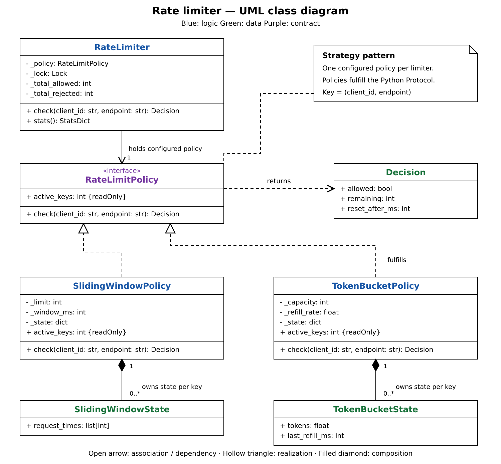

# Rate limiter design

`RateLimiter` owns locking and statistics. A configured `RateLimitPolicy` owns
settings, its clock, and state per `(client_id, endpoint)`. These notes cover
`rate_limiter.py`; `lc_rate_limiter.py` is a separate variant.

## Reading the UML

1. **Start with `RateLimiter`:** owns the lock and counters; delegates decisions to one policy.
2. **Follow `RateLimitPolicy` to its implementations:** Strategy lets sliding window or token bucket change without changing locking or statistics.
3. **Follow each policy to its state:** sliding window stores accepted timestamps; token bucket stores tokens and refill time. Both track state per client/endpoint.
4. **Settings and clock belong to the policy:** each algorithm owns its rules; an injected clock makes time controllable.
5. **Follow `Decision` back to the caller:** both policies return allowed, remaining capacity, and retry wait. The limiter updates its counters before returning.

## Happy path

1. Caller constructs a policy with validated settings and passes it to `RateLimiter`.
2. `RateLimiter.check(client_id, endpoint)` acquires its lock and calls the policy.
3. The policy finds or creates the key's state and reads its clock.
4. Sliding window removes expired timestamps and records the accepted request;
   token bucket refills up to capacity and consumes one token.
5. The policy returns an allowed `Decision` with remaining capacity and zero wait.
6. The limiter increments its allowed counter, unlocks, and returns the decision.

## Design BOW

- **Composition:** Inject a policy rather than subclassing the limiter.
- **Sliding window:** Sorted accepted timestamps; discard the expired prefix.
- **Token bucket:** Lazy refill on requests; preserve fractional tokens and round retry waits upward.
- **Clock injection:** Nondecreasing integer milliseconds; default `time.monotonic_ns()`.
  Pass `clock=lambda: now_ms` to either policy to control time without sleeping.
- **Statistics:** `stats()` returns strategy name, allowed/rejected totals, and tracked key count.

## GoF patterns

| Pattern      | Where                                                                                  | Purpose                                                           |
| ------------ | -------------------------------------------------------------------------------------- | ----------------------------------------------------------------- |
| **Strategy** | `RateLimiter` holds a `RateLimitPolicy`; sliding window and token bucket implement it. | Swap algorithms without changing locking, statistics, or callers. |

## SOLID principles

| Principle                 | Where / how                                                                                         |
| ------------------------- | --------------------------------------------------------------------------------------------------- |
| **Single Responsibility** | Policies handle rate-limit decisions and state; the limiter handles synchronization and statistics. |
| **Open/Closed**           | Add a policy implementing `check()` and `active_keys` without changing `RateLimiter`.               |
| **Dependency Inversion**  | `RateLimiter` accepts the abstract policy contract; the caller selects the concrete implementation. |

## Concurrency

| Concern                   | Implementation                                                                                 |
| ------------------------- | ---------------------------------------------------------------------------------------------- |
| **Over-admission**        | One lock covers policy reads, decisions, and state changes.                                    |
| **Consistent statistics** | Counter updates and `stats()` use the same lock.                                               |
| **State ownership**       | Use a separate policy instance per limiter; sharing one puts its state behind different locks. |
| **Tradeoff**              | All keys serialize through one limiter lock; state and limits are local to this process.       |

## common mistakes

- Lock the whole decision/update operation; policies are not independently synchronized.
- Key by both client and endpoint; client-only keys mix unrelated quotas.
- Keep time monotonic and units consistent; refill rates are tokens per second.
- Retain fractional tokens; ceil the wait for the missing fraction.
- Check sliding-window boundaries: this implementation retains timestamps exactly at the cutoff.
- `active_keys` counts tracked keys, not recent activity; idle entries are never evicted.
