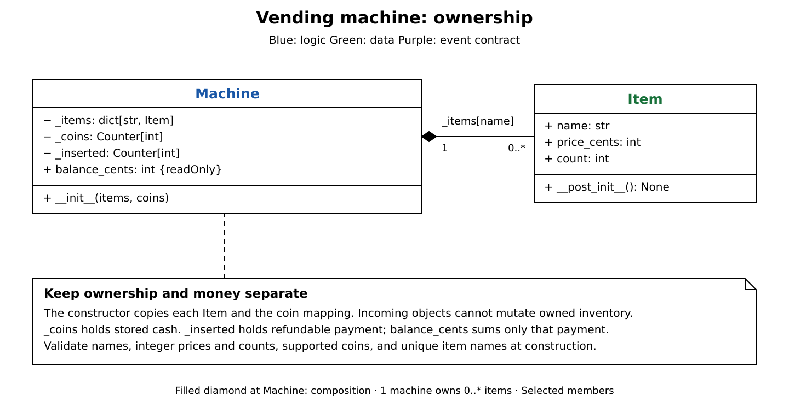
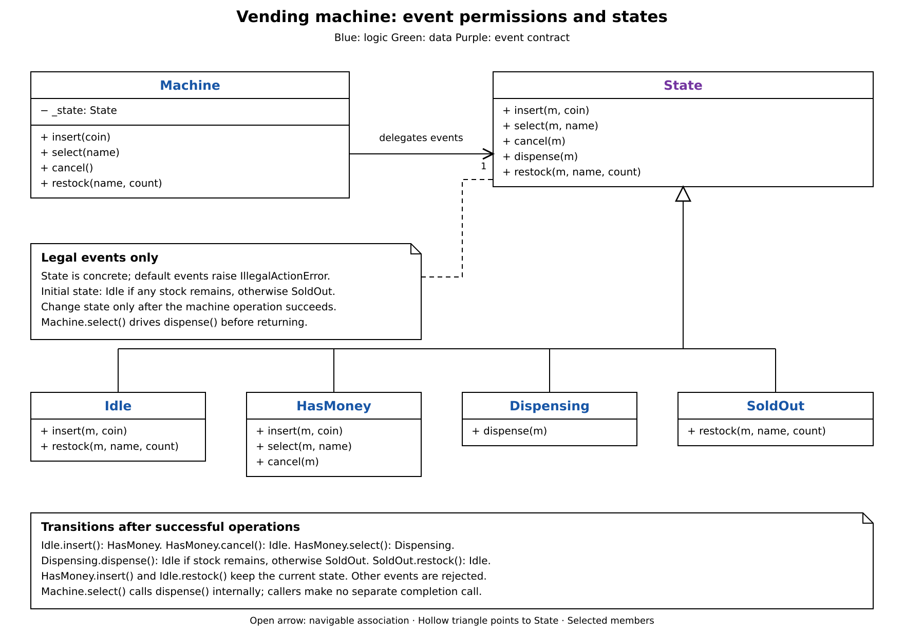
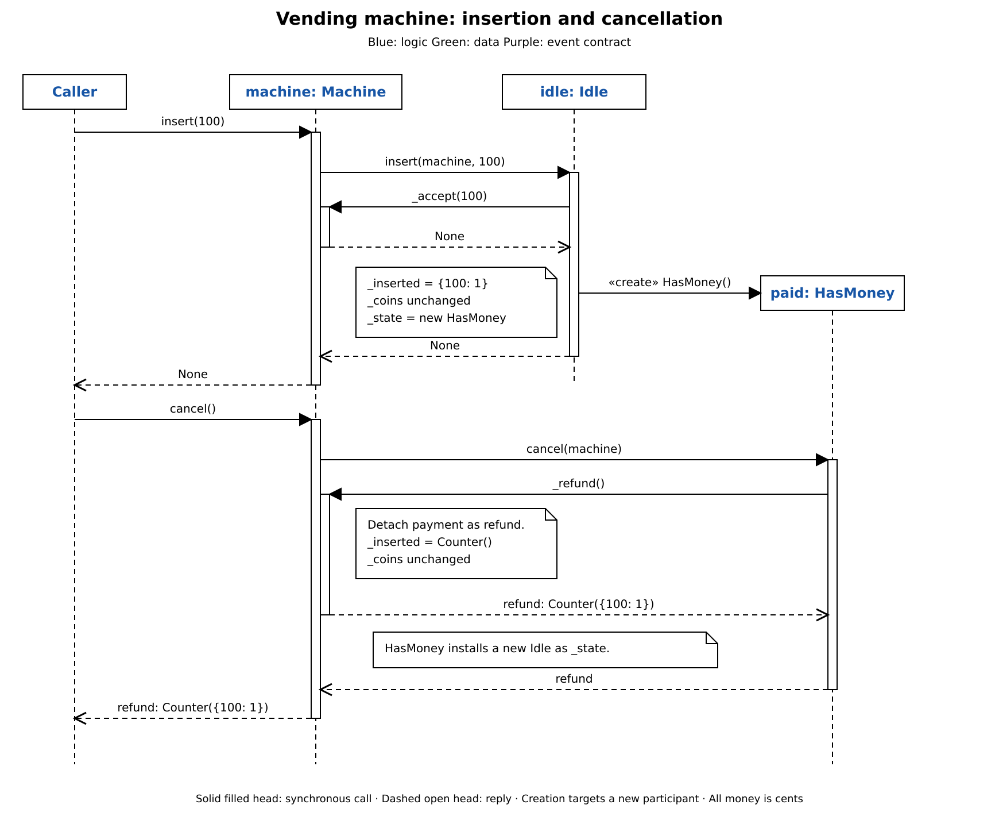
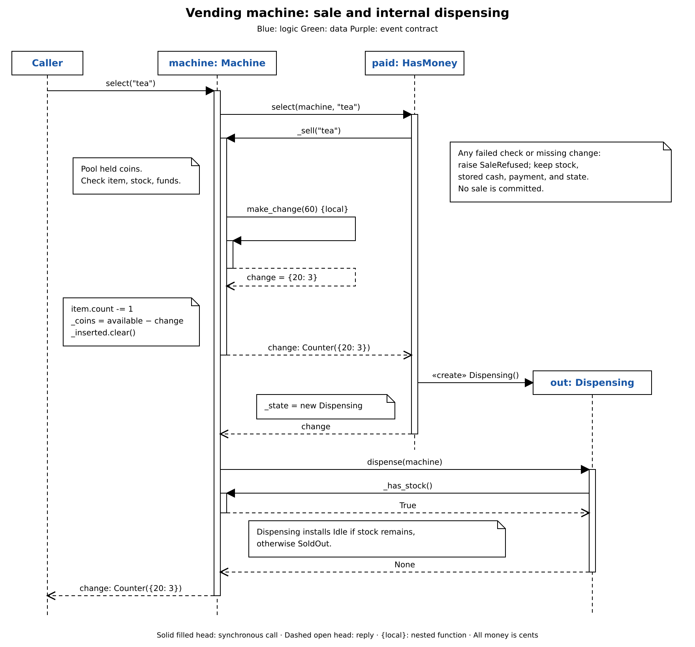

# Vending machine: breakdown

[Vending machine design](vending_machine.md) explains the complete implementation,
walkthrough, and concurrency limits. Reconstruct the design in four parts.

| Part | Add |
| --- | --- |
| 1. Ownership | Copied inventory, stored cash, and separate customer payment. |
| 2. States | Legal events and transitions for one customer flow. |
| 3. Payments | Coin insertion, balance, and cancellation. |
| 4. Sales | Validation, bounded change-making, commit, and completion. |

Diagrams show selected members. All money is integer cents; calls are sequential
and dispensing always succeeds.

## Part 1: Ownership

Start with the data a machine must keep consistent.

- `Item` holds `name`, `price_cents`, and `count`. Validate a nonblank name, a positive integer price, and nonnegative integer stock.
- `Machine` copies each item into `_items` and copies the initial coin mapping into `_coins`. Reject duplicate names, unsupported coins, and invalid counts.
- Add `_inserted` for the current payment. `balance_cents` sums its coin values; `_coins` remains stored cash until a purchase commits.

Keeping the counters separate lets cancellation return the payment without
touching stored cash.

## Part 2: States

The same event needs different permissions as a customer moves through a purchase.
Add `_state` to the existing machine and delegate public events to it.

`State` is a concrete base whose methods raise `IllegalActionError`. `Idle`,
`HasMoney`, `Dispensing`, and `SoldOut` override only legal events. This is the
State pattern: state objects choose transitions, while machine operations change
inventory and payment. `dispense()` is an internal state event; the public machine
API contains only `insert()`, `select()`, `cancel()`, and `restock()`.

Start in `Idle` when `_has_stock()` is true, otherwise `SoldOut`. Restocking is
legal in either state, requires a known item and a positive integer count, and
makes a sold-out machine idle. Change state only after the operation succeeds.

## Part 3: Payments

Reuse the machine's `_inserted` counter to collect a refundable payment.

1. `Machine.insert(100)` delegates to `Idle.insert()`. `_accept()` validates the coin and increments `_inserted`; `Idle` then installs `HasMoney`.
2. Further insertions use `HasMoney.insert()` and leave the state unchanged. Neither path changes stored cash.
3. `Machine.cancel()` delegates to `HasMoney.cancel()`. `_refund()` detaches and returns `_inserted`, replacing it with an empty counter; the handler installs `Idle`.

An invalid coin leaves the payment and state unchanged. Returning the detached
counter lets the caller handle the refund without exposing future payments.

## Part 4: Sales

A payment is only useful if the machine can deliver an item and exact change.
Add `_sell()` to the existing machine; `HasMoney.select()` commits the purchase and
installs `Dispensing`. `Machine.select()` drives both stages before returning.

1. `_sell()` combines `_coins` and `_inserted` into a temporary `available` counter. Check the item exists, has stock, and is affordable.
2. Its nested `make_change()` searches held coins for the remaining amount. Keep the fewest coins for each reachable amount; scan amounts downward so a physical coin cannot be reused.
3. A failed check raises `SaleRefused` with a `Reason`. An unreachable change amount gives `NO_CHANGE`. Inventory, payment, stored cash, and state remain unchanged.
4. On success, decrement stock, set `_coins = available - change`, and clear `_inserted`. `HasMoney.select()` installs `Dispensing` and returns the change to `Machine.select()`.
5. `Machine.select()` invokes `_state.dispense(self)`. `Dispensing.dispense()` checks remaining stock and installs `Idle` or `SoldOut`; only then does the public method return change to the caller.

For a 140-cent tea bought with 200 cents, `{50: 1, 20: 3}` can provide 60 cents as
three twenties. Greedy selection would take the fifty and get stuck. The bounded
search finds the valid combination before anything is committed.
