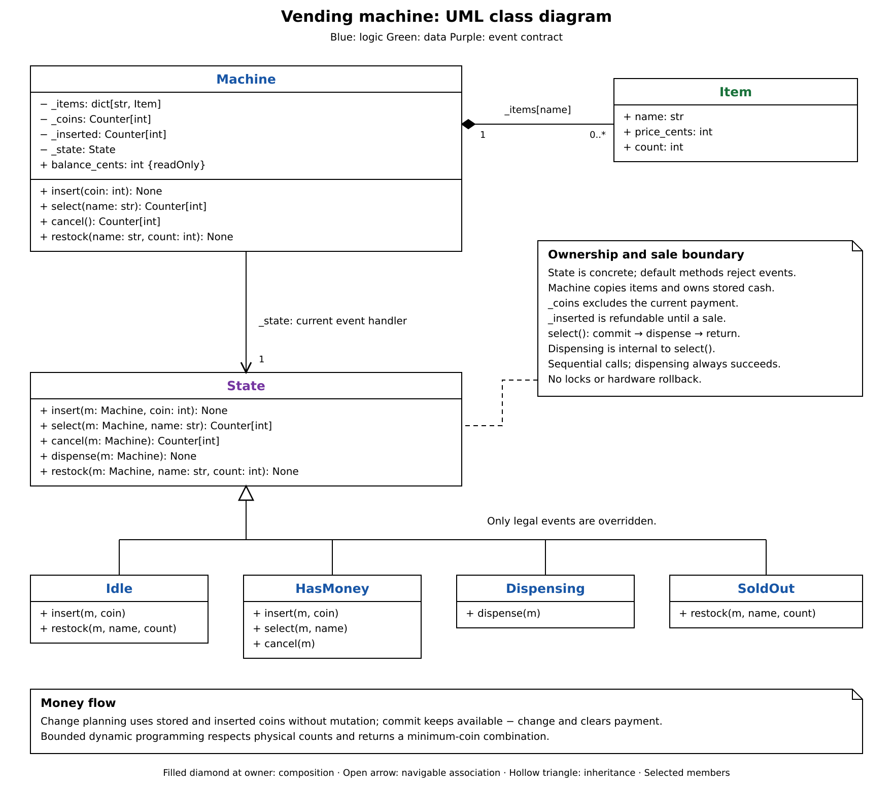

# Vending machine design

`Machine` owns inventory, available coins, inserted payment, and its current
`State`. States decide which actions are allowed and when the machine changes state.

## Reading the UML

1. **Start with `Machine`:** callers use `insert()`, `select()`, `cancel()`, `dispensed()`, and `restock()`; each delegates to the current state.
2. **Follow `State` to its subclasses:** State moves event handling into `Idle`, `HasMoney`, `Dispensing`, and `OutOfService`, avoiding a central state switch. The concrete base rejects events unless a subclass overrides them.
3. **Connect inventory and money:** `Item` holds price and stock; `coins` holds all available cash, including the current payment. `inserted` tracks that payment separately for balance and refunds.
4. **Follow selection back to the caller:** machine helpers plan change and commit the sale; `select()` returns the change. `dispensed()` later acknowledges completion.

## Happy path

1. Caller inserts a supported `Decimal` coin into an `Idle` machine.
2. `Idle.insert()` calls `_accept()`, adding the coin to `coins` and `inserted`, then enters `HasMoney`.
3. `select(name)` delegates to `HasMoney`, which checks the item, stock, and balance.
4. `_change_for()` finds makeable change using the coins actually held.
5. `_commit_sale()` reduces stock, removes change, and clears inserted payment. The state becomes `Dispensing`; `select()` returns the change.
6. Caller invokes `dispensed()`. The machine enters `Idle` if any stock remains, otherwise `OutOfService`.

## Design BOW

- **State:** Override only legal events; inherited methods reject the rest.
- **Change making:** Bounded dynamic programming finds the fewest coins, respecting physical counts; greedy selection can miss a valid answer.
- **Commit ordering:** Confirm stock, funds, and change before mutating the sale. Refused purchases leave payment available for retry or cancellation.
- **Errors:** `IllegalActionError` identifies an event forbidden in the current state. `SaleRefused` carries a `Reason`, separating purchase failures without one exception class per reason.

## GoF patterns

| Pattern | Where | Purpose |
| --- | --- | --- |
| **State** | `Machine.state`, `State`, and four subclasses | Change allowed actions and transitions without a central state switch. |

## SOLID principles

| Principle | Where / how |
| --- | --- |
| **Single Responsibility** | Machine helpers manage inventory and cash; states choose valid events and transitions. |
| **Open/Closed** | State-specific behavior lives in subclasses; machine forwarding methods stay unchanged. New event types still require interface changes. |

## Concurrency

| Concern | Implementation |
| --- | --- |
| **Transaction ownership** | One shared payment and state; supports one customer flow at a time. |
| **Atomic sale** | No locks. Change planning and commit must run sequentially; concurrent calls can race. |

## common mistakes

- Plan change before committing; count held coins rather than assuming unlimited denominations.
- Inserted coins already belong to `coins`; cancellation removes them and clears the payment.
- The sale commits in `select()`, before `dispensed()`. Physical dispensing failures have no rollback here.
- Constructor and restock inputs are not fully validated; the exercise assumes valid stock, coin counts, and nonnegative cent-based prices.
