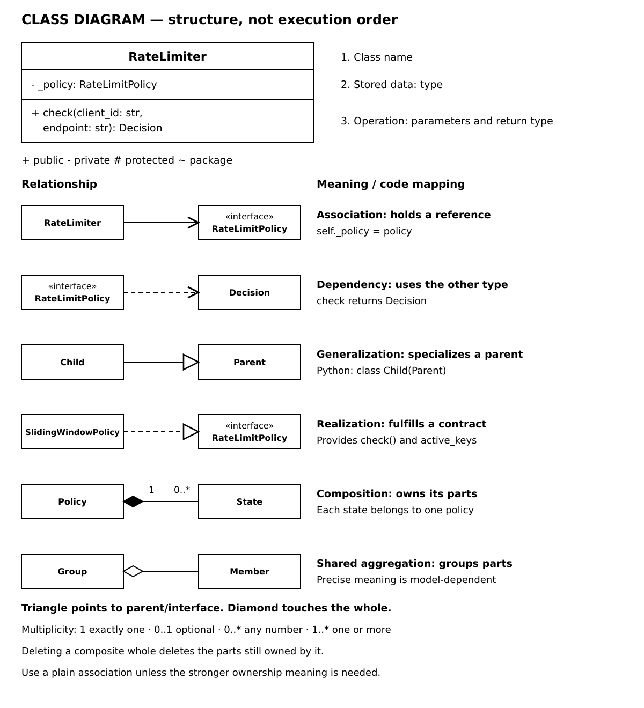
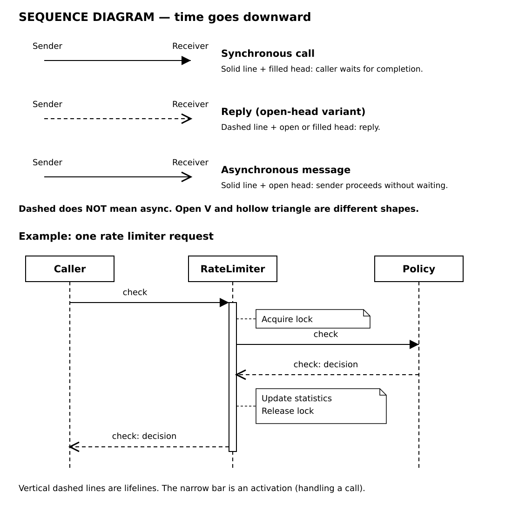
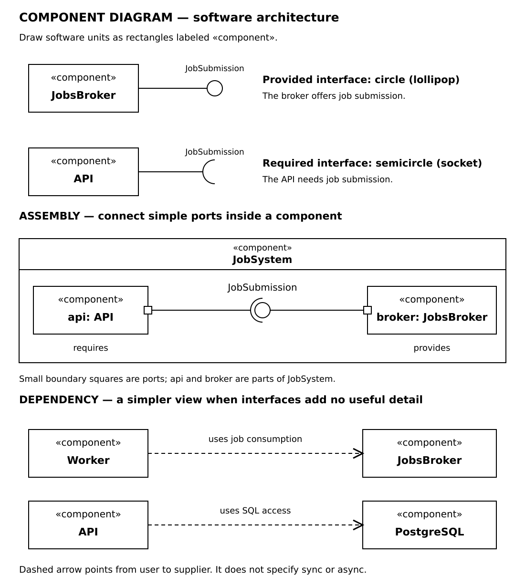

# UML

**For agents:** Use standard UML. Teach with SVGs for pen-and-paper drawing,
not Mermaid syntax.

| Question | Diagram |
| --- | --- |
| Classes and relationships? | Class |
| Calls and events in order? | Sequence |
| Software units and interfaces? | Component |
| Where does software run? | Deployment |

## Class

- Triangle points to parent/interface; diamond sits at the owner.
- Open V ≠ hollow triangle.
- `1` exactly one; `0..1` optional; `0..*` any number; `1..*` one or more.
- `+` public; `−` private; `#` protected; `~` package. Python access is conventional.
- Shared aggregation's precise meaning is model-dependent.

## Sequence

Time runs downward. Horizontal arrows are messages; vertical dashed lines are
lifelines. Narrow bars show activations; folded-corner boxes are comments.

- Solid + filled head: synchronous call.
- Solid + open head: asynchronous message.
- Dashed + open or filled head: reply. **Dashed does not mean async.**

## Component

- Circle: provides an interface. Socket: requires an interface.
- Small boundary square: port.
- Circle fitted into socket: assembly between simple ports of internal parts.
- Dashed arrow: dependency, from user to supplier.

These connections show structure. Use a sequence diagram for order and sync/async.

Reference: [UML 2.5.1](https://www.omg.org/spec/UML/2.5.1/PDF), §§9–11, 17.

## Personal colors

| Color | Use for |
| --- | --- |
| 🔵 Blue | Logic: services, workers, concrete classes |
| 🟢 Green | Data: databases, caches, state, data objects |
| 🟠 Orange | Messaging: brokers, queues, event labels |
| 🟣 Purple | Contracts: interfaces, abstract classes |
| 🔴 Red | Problems: failures, errors, unresolved questions |

Color names or add a small accent beside boxes; keep arrows and symbols black.
Use the same color for a participant's sequence-diagram heading. These colors
are personal reading aids; UML shapes retain their meaning without them.
